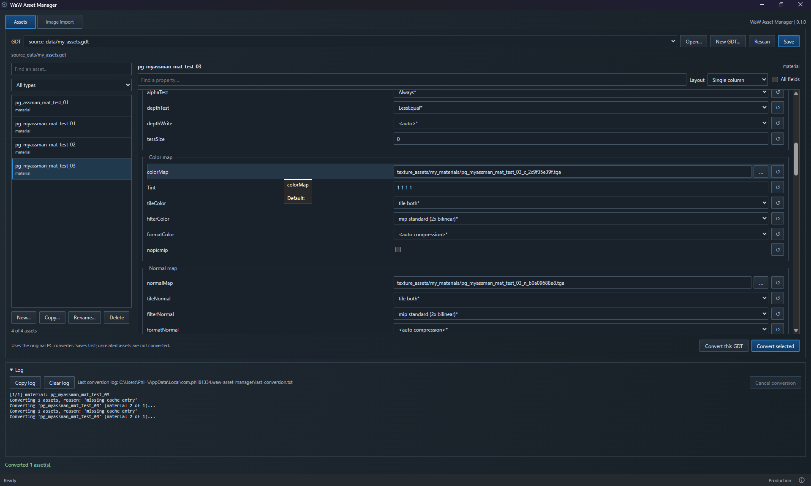

# WaW Asset Manager

**An unofficial community app. Not affiliated with Treyarch, Activision or UGX.**

Edit World at War Modtools assets with a new UI and the original Treyarch converter. Import PNG/TGA textures, assign their roles and optionally resize them. Made by [phil81334](https://github.com/phil81334). Built with JavaScript, Rust, Vite and Tauri.



[Responsive layout](images/waw-asset-manager-stock-section-layout.png) · [Image import](images/waw-asset-manager-import-tab.png)

## Download and run

1. Have World at War and its Modtools installed in the same game folder.
2. Open [Releases](https://github.com/phil81334/waw-asset-manager/releases/latest). Under **Assets**, download **waw-asset-manager.exe**. The source-code ZIP is for development.
3. Put the EXE beside `CoDWaW.exe`, then double-click it.

Release users need no development tools. Windows needs [WebView2](https://developer.microsoft.com/microsoft-edge/webview2/#download-section), usually already installed; if missing, install its **Evergreen Bootstrapper**. This app does not install Modtools or patches.

## Use it

**Assets:** open or create a GDT, select an asset and edit its properties. Save, then convert the selected asset or the current GDT through your installed `bin/converter.exe`. Choose **Single column** or **Responsive columns** for the property layout.

Select or enter a PNG in an image field to make a TGA beside it, without resizing. The field shows the resulting path. Originals are kept and generated names avoid clashes.

**Image import:** drop in PNG/TGA files, check their material names and texture roles, then prepare copies and add them to your GDT. Naming rules use `{name}` with your own prefixes/suffixes. Ambiguous matches need manual assignment.

This tab saves TGA copies in `texture_assets/<project>`. Keep dimensions, choose custom dimensions, or fit the batch to a common power-of-two square. No upscaling. The app asks before changing proportions.

Installed Modtools schemas supply the fields and defaults. Unknown stored properties are preserved. CGFX-specific automation, 16-bit PNG, shader previews and automatic PBR conversion are not included. Existing DDS references use the native converter's restrictions; image import accepts PNG/TGA only.

GDTs are saved in place. Asset deletion affects the GDT, not compiled files. Conversion blocks duplicate type/name entries and conflicting image output names. **Cancel conversion** stops this app's converter only. Failed/cancelled builds leave outputs as written by the native tool; there are no backups or automatic rollback.

Preferences and the last conversion log live in `%LOCALAPPDATA%\com.phil81334.waw-asset-manager`. No registry associations. Treyarch's tools and game assets are not bundled.

## Run from source

**Windows setup — do this once.** Skip anything already installed.

| Install                                                                                 | What to choose                                                                         |
| --------------------------------------------------------------------------------------- | -------------------------------------------------------------------------------------- |
| [VS Code](https://code.visualstudio.com/)                                               | The Windows installer. Open the project here.                                          |
| [Node.js](https://nodejs.org/en/download)                                               | **LTS**, **Windows**, **Installer (.msi)**. Keep defaults; npm is included.            |
| [Microsoft C++ Build Tools](https://visualstudio.microsoft.com/visual-cpp-build-tools/) | Select **Desktop development with C++**. Keep the selected MSVC tools and Windows SDK. |
| [Rust](https://rust-lang.org/tools/install/)                                            | Run **rustup-init.exe (x64)** and choose the default installation.                     |

Close and reopen VS Code after installation. [Tauri's Windows guide](https://v2.tauri.app/start/prerequisites/#windows) has more help. Vite and Tauri are installed by the project; no separate installation or Python is needed.

1. Choose **Code → Download ZIP** on this page and extract it, or clone the repository if you use Git.
2. In VS Code, choose **File → Open Folder** and open the folder containing `package.json`.
3. In VS Code's Explorer, create a folder named `.local`, then a file inside it named `game-path.txt`.
4. In Windows File Explorer, open your WaW folder—the one containing `CoDWaW.exe`. Click the address bar, copy the full folder address into `game-path.txt` and save. Use your actual drive/folder. One line, no quotes or EXE filename.
5. Choose **Terminal → New Terminal** and run these commands one at a time:

   ```powershell
   npm install
   npm run dev
   ```

`npm install` downloads dependencies; `npm run dev` opens the desktop app. The first build downloads and compiles Rust dependencies, so give it time. Keep the terminal open; **Ctrl+C** stops development.

Next time, run `npm run dev` or click **dev**'s play button in VS Code's **NPM Scripts** panel. If hidden, right-click the Explorer headings and enable **NPM Scripts**. Update `game-path.txt` if WaW moves. The packaged EXE always uses its own folder instead.

Development uses the folder you choose and can save/convert real assets. Without a saved path it uses `.local/test-root`; it never guesses your Steam folder.

| Command             | What it does                                                                      |
| ------------------- | --------------------------------------------------------------------------------- |
| `npm run dev`       | Opens the desktop app for development.                                            |
| `npm run dev:web`   | Previews the UI in a browser. Cannot read GDTs, prepare images or convert assets. |
| `npm run build`     | Creates `release/waw-asset-manager.exe`.                                          |
| `npm run build:web` | Builds UI files only. No EXE.                                                     |

To make your own EXE, run `npm run build`, then copy `release/waw-asset-manager.exe` beside `CoDWaW.exe`.

[Credits](ATTRIBUTION.md) · [GPL-3.0 licence](LICENCE)
